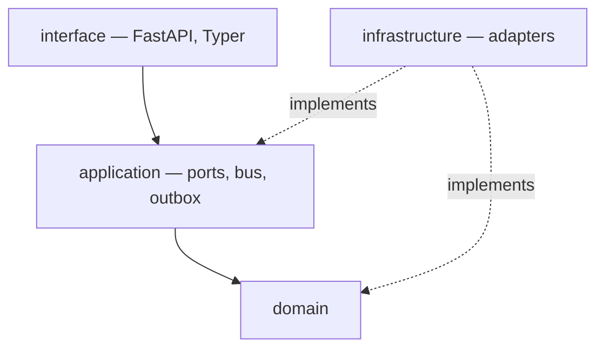
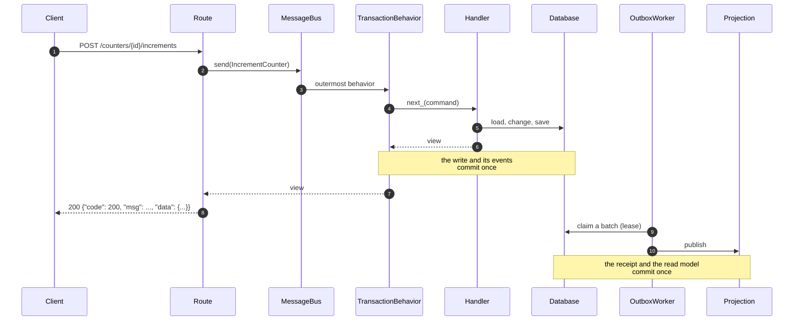

# fastddd

A framework-agnostic DDD/CQRS kernel for asynchronous Python services.

`fastddd` provides the parts that are the same in every service — a domain model with
identity, aggregates, invariants and pagination; an application layer with explicit ports, a
message bus and a transactional outbox; adapters for SQLAlchemy, structured logging and
layered YAML configuration; and thin FastAPI and Typer bindings — while leaving every
decision it _cannot_ make for you to the composition root.

It is a **library, not an application**: there is no `main()`, no module-level container, and
no configuration file the kernel reads on its own. Nothing inside it resolves a path, a URL,
a secret, a clock or an identifier by itself; the caller hands each of those in. That is what
lets the same code serve a SQLite single process, a Postgres deployment and a Databricks
Lakebase endpoint without a branch anywhere in the middle.



Dependencies point inward only. `domain` imports nothing from the project, `application`
imports `domain`, `infrastructure` implements both layers' ports, and `interface` translates
a transport into application calls.

## Table of contents

- [Design stance](#design-stance)
- [Requirements and installation](#requirements-and-installation)
- [Repository layout](#repository-layout)
- [Main features](#main-features)
- [The shape of an application](#the-shape-of-an-application)
- [The example service](#the-example-service)
- [What the kernel guarantees](#what-the-kernel-guarantees)
- [Testing](#testing)
- [Conventions](#conventions)

## Design stance

Five decisions explain most of the code in this repository.

**One code path for one process and for many.** The outbox is claimed with a time-boxed lease
rather than a dialect-specific `SELECT … FOR UPDATE SKIP LOCKED`, so a single-process
deployment and a fleet of workers run the _same_ dispatcher; adding a worker is a deployment
decision, not a code change.

**At-least-once delivery, effectively-once consumption.** The kernel never claims exactly
once. A consumer that must not apply the same fact twice records the event it handled in the
inbox, inside its own transaction, so a redelivery is a no-op and a rollback takes the receipt
back with the work it guarded.

**Configuration is data, not knowledge.** `ConfigResolver` is handed a directory, a list of
profiles and a pydantic model; the persistence adapter is handed a config object; the CLI
factory is handed a directory, a revision pattern, a URL, an environment variable name, a
program name, a metadata root, a list of model modules and an optional engine factory. The
kernel knows no file name, no environment prefix and no project layout.

**Time and identity are injectable.** Adapters take `now: Callable[[], datetime]` and mint
identifiers through `UuidGenerator`, so a test can pin the clock and the ids without patching
a module.

**One public surface per layer.** `fastddd.domain`, `.application`, `.infrastructure` and
`.interface` each publish a facade with an explicit `__all__`; sub-packages publish their own,
smaller one.

## Requirements and installation

- Python **3.13** or newer (the code uses PEP 695 generics and `type` aliases)
- [`uv`](https://docs.astral.sh/uv/) for the environment and the tooling

```bash
uv sync                      # development environment (Postgres driver, no SQLite)
uv sync --extra sqlite       # a deployment that talks to SQLite
uv sync --extra postgres     # a deployment that talks to Postgres
uv sync --extra databricks   # Postgres via Databricks Lakebase
```

The distribution is named `fastddd`, and so is the import package: the repository root is
the import root, so every import reads `from fastddd…`. Database drivers are optional extras
on purpose: the engine is runtime
code, the driver is a deployment choice, and `create_database_backend` imports it lazily.

```python
from fastddd.domain import Aggregate, EntityId  # domain building blocks
from fastddd.application import Command, MessageBus  # use-case vocabulary
from fastddd.infrastructure import (  # adapters
    ConfigResolver,
    SqlAlchemyUnitOfWork,
    configure_logging,
    create_async_engine,
    create_session_factory,
)
from fastddd.interface import create_db_app  # transport bindings
```

## Repository layout

```
fastddd/
├── domain/                     # pure model: no I/O, no framework, no configuration
│   ├── aggregate.py            # Aggregate, VersionedAggregate, SoftDeletable
│   ├── entity.py               # Entity, EntityId
│   ├── error.py                # DomainError and the semantic vocabulary
│   ├── event.py                # DomainEvent marker
│   ├── invariant.py            # require_non_blank, require_timezone_aware
│   ├── pagination.py           # Page, PageRequest, encode/decode_cursor
│   ├── repository.py           # AggregateRepository (the write-side contract)
│   ├── service.py              # DomainService marker
│   ├── specification.py        # Specification with &, |, ~
│   └── value_object.py         # ValueObject
├── application/                # use-case vocabulary and the ports it needs
│   ├── execution/context.py    # Context, MessageMetadata, current_* readers
│   ├── integration/            # IntegrationEvent, Outbox, mapper/publisher ports,
│   │                           # registry, JSON serialization
│   ├── messaging/              # Message, Handler, Behavior, Pipeline, MessageBus,
│   │                           # handler/behavior/event registries
│   ├── ports/                  # Clock, IdGenerator, ReadStore, UnitOfWork
│   └── support.py              # require_found, enqueue_integration_events
├── infrastructure/             # adapters
│   ├── clock.py, identity.py   # SystemClock, UuidGenerator
│   ├── inbox.py                # claim_inbox_message, InboxConsumer,
│   │                           # projection_consumer
│   ├── configuration/          # ConfigResolver, pydantic schemas
│   ├── logging/                # configure_logging, get_logger, LoggingBehavior
│   ├── messaging/              # OutboxDispatcher, OutboxWorker, TransactionBehavior,
│   │                           # InMemoryIntegrationEventPublisher
│   └── persistence/sqlalchemy/ # engine, session, unit of work, outbox, repositories,
│                               # record mapper, pagination, retention cleanup
└── interface/                  # transports
    ├── cli/                    # create_db_app (Typer), Alembic scaffolder
    └── http/                   # response envelope, error mapping, request log, bearer

examples/                       # a complete service built on the kernel
├── counter/                    # one bounded context, all four layers
├── composition/                # container, wiring, process
├── config/                     # the layers the service reads
├── cli.py                      # the console entry point
└── README.md                   # the walkthrough

tests/                          # mirrors fastddd/, one module per module
```

## Main features

**Domain**

- `EntityId` identity by type and value, `Entity` equality by identity, `Aggregate` as a
  transactional boundary that records domain events, `VersionedAggregate` for optimistic
  concurrency, `SoftDeletable` for a terminal, auditable delete.
- Invariant helpers that fail with one exception type: `require_non_blank(value, field=…)` and
  `require_timezone_aware(value, field=…)`.
- Cursor pagination (`Page`, `PageRequest`, opaque `encode_cursor`/`decode_cursor`) — an
  offset would repeat or skip rows while a table is being written.
- Composable `Specification`s and a `ValueObject` base.
- The error vocabulary: `DomainError` plus `InvariantViolationError`,
  `BusinessRuleViolationError`, `AggregateDeletedError`, `NotFoundError`, `ConflictError`,
  `AuthenticationRequiredError` and `AuthorizationDeniedError`. A subclass may name itself
  with `code`, which is what a client branches on while the message stays prose.

**Application**

- `Command`/`Query` messages, `CommandHandler`/`QueryHandler`/`EventHandler`, and `Behavior`
  middleware composed by `Pipeline` around the handler.
- `MessageBus.send(command)` / `.ask(query)`, resolving exactly one handler per message type
  and a behavior chain (globals first, then message-specific).
- One ambient `Context` per execution: metadata plus the transaction, read through
  `current_metadata()` / `current_unit_of_work()` instead of being threaded through every call.
- `UnitOfWork` as the transactional boundary, exposing the `Outbox` bound to the same
  transaction; `enqueue_integration_events(uow, mapper, metadata)` is the single place a use
  case's recorded facts become publishable events.
- `ReadStore` for read models that must not load aggregates, and `require_found(load, subject=…,
error_type=…)` so repositories stay plain lookups that return `None`.

**Infrastructure**

- `create_async_engine` / `create_session_factory` for any async dialect. SQLite gets its safe
  single-node PRAGMAs _and_ takes transaction control away from the driver, so a savepoint
  written as the first statement of a transaction still nests and is rolled back with the work
  around it.
- `SqlAlchemyUnitOfWork`, `SqlAlchemyMappedRepository` (declare `record_type` and `mapper`, get
  load/save/soft-delete filtering for free), `AggregateRecordMapper` for row translation, and a
  shared `fetch_page` for cursor lists.
- `SqlAlchemyOutbox` with `append`, lease-based `claim(limit, worker, lease_seconds)`,
  worker-guarded `mark_as_published`/`mark_failed` (capped exponential backoff, a terminal
  `dead` state after `max_attempts`), and `purge_published(before)`.
- `OutboxDispatcher` publishes a leased batch _outside_ the read transaction and settles it in
  one later transaction; `OutboxWorker` drains dispatchers on an interval and, given a
  `sweeper`, deletes finished rows past their retention with a jittered cadence.
- `claim_inbox_message` / `InboxConsumer` / `projection_consumer` for idempotent consumption,
  keyed by an explicit consumer name so one consumer's success never suppresses a sibling's
  retry.
- `ConfigResolver(config_dir, profiles, schema)` — layered YAML, merged by priority, validated
  by pydantic, with no default directory and no default file.
- `configure_logging(LoggingConfig)` for structlog (JSON or colored console) with logger
  silencing; `get_logger(name)`; `bind_context(**values)`; `LoggingBehavior`.
- `SystemClock.now` and `UuidGenerator.new` — the layer's single source of "now" and of new
  identifiers.

**Interface**

- `create_db_app(...)` builds a Typer sub-application with the full Alembic command set
  (`init`, `revision`, `upgrade`, `downgrade`, `current`, `history`, `heads`, `branches`,
  `show`, `stamp`, `check`, `merge`) from parameters alone, and `scaffold_environment` writes
  the `env.py` those commands run.
- FastAPI vocabulary: a standard `ResponseModel`/`ResponseSchemaModel` envelope, an error
  vocabulary for the transport, `register_domain_error_handler` (one handler per app, many
  contexts' status tables, most specific rule wins), `RequestLoggingMiddleware`, and the OAuth2
  bearer declaration for the docs page.

## The shape of an application

The kernel never assembles itself: it has no entry point, no container, and no
configuration file it reads on its own. A service supplies all three, and the
split is always the same one.



Four things in that picture are worth stating plainly:

- **The route decides nothing.** It validates its input, turns it into a command
  or a query, and wraps the answer in the standard envelope.
- **The handler owns no transaction.** `TransactionBehavior` opens one, binds it
  as the ambient `Context`, and commits _after_ the handler has returned — with the
  handler's recorded facts translated into the outbox on the way, so a write and
  the events it produces leave together or not at all.
- **Publication is not the command's problem.** A worker claims a leased batch
  later, so a caller never waits for a consumer, and a crash in between loses
  nothing.
- **Consumption is idempotent.** The receipt for an event is written inside the
  consumer's own transaction, so a redelivery is a no-op and a failure retries.

The smallest honest sketch of that, in the kernel's vocabulary:

```python
# 1. domain -- the model, and nothing else
class Counter(Aggregate[UUID]):
    """A labelled counter that records one fact per change."""

    def increment(self, *, by: int = 1) -> None:
        """Advance the counter and record the fact."""
        self._require_not_deleted(action="increment")
        if by < 1:
            raise InvariantViolationError("a counter advances by at least one")

        self.total += by
        self._record_event(CounterChanged(self._id.value, self.label, self.total))


# 2. application -- a message, and the handler that serves it
@dataclass(frozen=True, slots=True)
class IncrementCounter(Command[CounterView]):
    """Ask a counter to advance."""

    counter_id: UUID
    by: int = 1


class IncrementCounterHandler(CommandHandler[IncrementCounter, CounterView]):
    """Load one aggregate, change it, and store it."""

    def __init__(self, counters: AggregateRepository[Counter, UUID]) -> None:
        self._counters = counters

    async def handle(self, command: IncrementCounter) -> CounterView:
        """Advance the counter named by the command."""
        counter = await require_found(
            self._counters.get(CounterId(command.counter_id)),
            subject=f"counter {command.counter_id}",
            error_type=CounterNotFoundError,
        )
        counter.increment(by=command.by)
        await self._counters.save(counter)

        return CounterView(counter.id.value, counter.label, counter.total)


# 3. infrastructure -- the adapter the port was waiting for
class CounterRepository(SqlAlchemyMappedRepository[Counter, CounterRecord, UUID]):
    """Write side: bind the aggregate to the ambient unit of work."""

    record_type = CounterRecord
    mapper = CounterMapper()


# 4. interface -- a transport that only translates
@router.post(
    "/{counter_id}/increments",
    response_model=ResponseSchemaModel[CounterView],
)
async def increment_counter(
    counter_id: UUID,
    payload: IncrementCounterRequest,
) -> ResponseSchemaModel[CounterView]:
    """Advance a counter, returning its new total."""
    return ResponseSchemaModel[CounterView](
        data=await bus.send(IncrementCounter(counter_id=counter_id, by=payload.by))
    )


# 5. composition -- the only place that knows every layer exists
class AppContainer(containers.DeclarativeContainer):
    """Every object this process is built from."""

    settings = providers.Singleton(_resolve_settings)
    engine = providers.Singleton(_database_engine, database)
    session_factory = providers.Singleton(create_session_factory, engine)
    uow = providers.Factory(SqlAlchemyUnitOfWork, session_factory, now=SystemClock.now)
    clock = providers.Singleton(SystemClock)
    identifiers = providers.Singleton(UuidGenerator)
    counter_repository = providers.Singleton(CounterRepository)
```

## The example service

[`examples/`](examples/) is that sketch as a program: one `Counter` context, a
composition root written with `dependency-injector`, the migration commands, and
the configuration it reads. `tests/test_examples.py` assembles it and runs a
command through the outbox into the read model, so the walkthrough cannot drift
away from the kernel's real API.

| File                                                            | What it shows                                                                                               |
| --------------------------------------------------------------- | ----------------------------------------------------------------------------------------------------------- |
| [`counter/domain.py`](examples/counter/domain.py)               | an aggregate, a typed identity, a domain event, a not-found error that names a `code`                       |
| [`counter/application.py`](examples/counter/application.py)     | commands, queries, handlers, and mapping a recorded fact into an integration event                          |
| [`counter/persistence.py`](examples/counter/persistence.py)     | rows hanging off the kernel's `Base`, a record mapper, a repository, a read store, an idempotent projection |
| [`counter/interface.py`](examples/counter/interface.py)         | routes that only translate, plus the context's status table                                                 |
| [`composition/container.py`](examples/composition/container.py) | the container: settings, engine, one unit of work per dispatch, ports, adapters                             |
| [`composition/wiring.py`](examples/composition/wiring.py)       | the registrations: handlers, behaviors, consumers, worker                                                   |
| [`composition/bootstrap.py`](examples/composition/bootstrap.py) | the ASGI application and the lifespan that owns the worker                                                  |
| [`cli.py`](examples/cli.py)                                     | `create_db_app(...)`, with all eight inputs handed in                                                       |
| [`config/config.base.yaml`](examples/config/config.base.yaml)   | the layered configuration the service reads                                                                 |

Run it:

```bash
uv sync --extra sqlite
uv run python -m examples.cli db init
uv run python -m examples.cli db revision "add counters"
uv run python -m examples.cli db upgrade head
uv run uvicorn examples.composition.bootstrap:create_app --factory --reload
```

[`examples/README.md`](examples/README.md) walks through each of those files and
explains the reasoning behind the decisions in them.

## What the kernel guarantees

| Concern     | Guarantee                                                                                                                                                        |
| ----------- | ---------------------------------------------------------------------------------------------------------------------------------------------------------------- |
| Publication | An event written by a command is in the same transaction as the write, so it is never half-published. Delivery is **at least once**.                             |
| Concurrency | Claiming leases a batch, so two dispatchers never publish the same row; a lease that outlives its worker is reclaimed by the next claim.                         |
| Settlement  | `mark_as_published` / `mark_failed` are guarded by the claiming worker, so a worker whose lease was taken over cannot overwrite its successor's outcome.         |
| Failure     | A refused event keeps its reason, retries with capped exponential backoff, and ends as `dead` after `max_attempts` (default 10) instead of retrying forever.     |
| Consumption | A receipt and the work it guards commit together: a failure leaves neither behind, so the event is seen again on the retry.                                      |
| Retention   | `SqlAlchemyMaintenance.sweep(retention_seconds)` removes published events and processed receipts, and deliberately keeps `dead` ones for an operator to inspect. |
| Ordering    | Only within one aggregate version: a consumer may reject an event that arrives after a newer one. `UNVERSIONED` facts make no such claim.                        |

## Testing

The kernel is built so a test can replace each seam instead of mocking the world.

```python
from dependency_injector import providers

# Pin the clock and the identifier source through the providers that own them.
container.clock.override(
    providers.Object(FrozenClock(datetime(2026, 1, 1, tzinfo=UTC)))
)
container.identifiers.override(providers.Object(StubIdentifiers(uuid4(), uuid4())))

# Talk to a throwaway SQLite file instead of the deployment's database.
container.engine.override(
    providers.Singleton(create_async_engine, "sqlite+aiosqlite:///:memory:")
)
```

- A **handler** test enters `Context(unit_of_work=uow)` itself and asserts on what the unit
  of work collected through `uow.pull_events()`, without starting a worker.
- A **consumer** test drives `InboxConsumer` / `projection_consumer` twice with the same event
  and asserts the work happened once.
- A **dispatcher** test uses `InMemoryIntegrationEventPublisher` with a registry whose consumer
  raises, then asserts the event came back with a `last_error` and a retry time.
- An **outbox** test uses `SqlAlchemyMaintenance` with a fixed `now` to assert that only
  finished rows past the retention window are removed.

[`tests/test_examples.py`](tests/test_examples.py) does the same thing to the example
service: it overrides the engine and the logging setup on the container, and then runs a
command through the real outbox into a read model.

The kernel's own suite is the reference: `tests/` mirrors `fastddd/`, one test module per
source module, with Postgres-only tests behind `-m integration`.

```bash
uv run pytest                                  # the fast, hermetic suite
docker compose -f tests/docker-compose.yml up -d --wait
uv run pytest -m integration                   # the dialect-specific tests
docker compose -f tests/docker-compose.yml down -v
```

## Conventions

- **Layers point inward.** `domain` and `application` never import `infrastructure` or
  `interface`. A repository contract belongs to the **domain**, a read store to the
  application, and SQLAlchemy never appears above the adapter.
- **Ports are protocols, implementations are adapters.** `Clock`, `IdGenerator`, `ReadStore`,
  `UnitOfWork`, `DomainEventMapper` and `AggregateRecordMapper` are structural contracts, so an
  implementation needs no base class — only the right shape.
- **One facade per package.** Every package has an `__init__.py` with a docstring and an
  `__all__`; `tests/test_packages.py` fails when one is missing.
- **One source module, one test module.** `fastddd/x/y.py` is covered by
  `tests/x/test_y.py`.
- **The example is code, not documentation.** `examples/` is linted and type-checked like
  everything else, and `tests/test_examples.py` assembles it and runs a command through the
  outbox, so it cannot drift away from the kernel's real API.
- **The gates are ruff, mypy (strict) and pytest:**

```bash
uv run ruff check . && uv run ruff format --check .
uv run mypy .
uv run pytest
```
