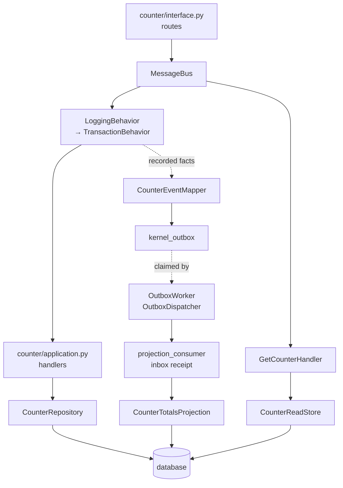

# The example service

A complete service built on `fastddd`: one bounded context, assembled with
`dependency-injector`, with the migration commands and the configuration it reads.

It is a real program, not a snippet. Ruff lints it, mypy type-checks it, and
`tests/test_examples.py` assembles the whole object graph and runs a command
through the outbox into a read model — so when a kernel signature changes, this
directory fails a gate instead of quietly going out of date.

## What it is

A `Counter`: a labelled counter that can be created, advanced, and read back.
Small enough to read in one sitting, and it exercises every part of the kernel
that matters.



| Concern                                                 | File                                                   |
| ------------------------------------------------------- | ------------------------------------------------------ |
| aggregate, typed identity, domain event, invariant      | [`counter/domain.py`](counter/domain.py)               |
| commands, queries, handlers, fact → event mapping       | [`counter/application.py`](counter/application.py)     |
| rows, record mapper, repository, read store, projection | [`counter/persistence.py`](counter/persistence.py)     |
| routes, request models, this context's status table     | [`counter/interface.py`](counter/interface.py)         |
| settings, engine, transactions, ports, adapters         | [`composition/container.py`](composition/container.py) |
| handlers, behaviors, consumers, the worker              | [`composition/wiring.py`](composition/wiring.py)       |
| the ASGI application and its lifespan                   | [`composition/bootstrap.py`](composition/bootstrap.py) |
| the migration commands                                  | [`cli.py`](cli.py)                                     |
| the layered configuration                               | [`config/config.base.yaml`](config/config.base.yaml)   |

## 1. The model — `counter/domain.py`

The domain imports the kernel's domain vocabulary and the standard library, and
nothing else: no I/O, no framework, no clock, no identifier source. That is what
makes it testable without a database, and it is why the timestamp a fact travels
with is _not_ here.

Three decisions in this file are worth copying:

**An identifier is its own type.** `CounterId` extends `EntityId[UUID]`, which
derives equality and hashing from the pair (type, value). Passing a counter's id
where a customer's is expected is a type error, not a production incident.

**A fact carries only what the aggregate knows.** `CounterChanged(counter_id,
label, total)` has no timestamp, no event id and no correlation id. Those describe
the _delivery_ of the fact; the aggregate is in no position to know them, and the
event mapper in the application layer adds them.

**Creation is a behaviour, not a constructor.** `Counter.create(...)` builds the
aggregate and records the fact, while `__init__` stays bookkeeping-only:

```python
@classmethod
def create(cls, id: CounterId, label: str) -> Counter:
    """Start a new counter at zero and record that it now reads that."""
    counter = cls(id, label)
    counter._record_event(CounterChanged(id.value, counter.label, counter.total))
    return counter
```

That split matters because the mapper rebuilds aggregates from rows: a
reconstituted aggregate must never record a fact it did not just produce.

`increment` is where the two kinds of refusal are separated — a deleted aggregate
(`AggregateDeletedError`, raised by `_require_not_deleted`) and a broken invariant
(`InvariantViolationError`). The transport maps the first to 404-adjacent logic
and the second to 400; the domain only knows that both are refusals.

## 2. The use cases — `counter/application.py`

Handlers depend on ports: the _domain's_ `AggregateRepository` and the
_application's_ `ReadStore`, `Clock` and `IdGenerator`. No SQLAlchemy import
appears in this file, which is what makes the same handlers run on SQLite and on
Postgres.

**A handler never commits.** `IncrementCounterHandler` loads, changes, and saves;
the transaction is `TransactionBehavior`'s business, one layer up. A handler that
committed would break the promise that a write and its events leave together.

**Not-found is the use case's decision.** The repository's `get` returns `None`,
and `require_found` is what turns that into this context's error:

```python
counter = await require_found(
    self._counters.get(CounterId(command.counter_id)),
    subject=f"counter {command.counter_id}",
    error_type=CounterNotFoundError,
)
```

That is why `CounterNotFoundError` extends the kernel's `NotFoundError`: the port
stays a plain lookup, and the context says what missing means.

**The mapper is not the aggregate.** `CounterEventMapper.map` turns a recorded fact
into an `IntegrationEvent`, taking the moment from the injected `Clock` and the
event's identity from the injected `IdGenerator`. Two consequences: a test can pin
both and assert on the exact bytes of a published event, and
`aggregate_version=UNVERSIONED` says out loud that this aggregate makes no
ordering claim instead of inventing a version number a consumer might trust.

## 3. The adapters — `counter/persistence.py`

**The tables hang off the kernel's `Base`.** One metadata root means one
`create_all` and one Alembic autogenerate see the kernel's `kernel_outbox` and
`kernel_inbox` tables together with this context's `example_counters` and
`example_counter_totals`. A separate declarative base would silently give you two
migration histories.

**A record mapper is four methods.** `AggregateRecordMapper` is a `Protocol`, so
`CounterMapper` declares no base class: `to_domain`, `to_record`, and the two
answers to _what is a live row_ — `is_deleted` for a row already loaded and
`not_deleted` for the SQL predicate a query needs. The generic repository is what
keeps the two of them consistent.

**A repository is two class variables.**

```python
class CounterRepository(SqlAlchemyMappedRepository[Counter, CounterRecord, UUID]):
    record_type = CounterRecord
    mapper = CounterMapper()
```

Loading, soft-delete filtering and insert-or-update come from the base class. The
adapter holds no session — it resolves the unit of work bound to the current
command on every call — so it is safe as a singleton and there is no lifetime to
get wrong.

**The read side opens its own session.** `CounterReadStore` reads committed state,
so it never blocks on, or sees half of, a write in flight. The price is honest and
worth stating: a projection that has not caught up yet answers exactly like a
counter that never existed.

**A projection writes in its consumer's transaction.** `_ambient_session()` exists
for one reason: the receipt `InboxConsumer` wrote and the read-model update have
to be one transaction, so a failure rolls both back and the event is delivered
again. Opening a second transaction here would look harmless and quietly weaken
the guarantee to at-least-once _application_.

```python
async def handle(self, event: IntegrationEvent) -> None:
    """Apply one ``counter.changed`` fact to the read model."""
    changed = CounterChangedPayload.of(event)
    session = _ambient_session()
    ...
```

The handler is deliberately not defensive about redelivery — the receipt already
handles it — but it does validate the payload, because an integration event
arrives as a string next to JSON and the consumer cannot see the producer's types.

## 4. The transport — `counter/interface.py`

Routes translate and nothing else: validate, build the message, `bus.send` or
`bus.ask`, wrap in `ResponseSchemaModel`.

**The request model is not the command.** `CreateCounterRequest` is the HTTP
contract, with its own bounds; `CreateCounter` is the use case's. They are allowed
to differ, and keeping them apart is what stops a validation rule from living in
two layers.

**The status table is data.** Each context contributes the statuses its own
failures travel under, and the kernel keeps one exception handler per application:

```python
COUNTER_STATUS_TABLE: StatusTable = (
    (CounterNotFoundError, status.HTTP_404_NOT_FOUND),
    (InvariantViolationError, status.HTTP_400_BAD_REQUEST),
)
```

An exact class match outranks an inherited one, so two contexts may both map
`DomainError` without the first one registered deciding every case.

## 5. The composition root

Three files, split by what they own: the container owns **lifetimes**, the wiring
owns the **shape** of the graph, and the bootstrap owns the **process**.

### `composition/container.py`

- **Singletons** for anything process-wide: the resolved settings, the engine, the
  session factory, the ports, the stateless adapters, the maintenance sweeper.
- **Factories** for anything holding a transaction. A `SqlAlchemyUnitOfWork` binds
  exactly one transaction, so a singleton would serialise every concurrent command
  behind it. `counter_read_model` is a factory for the same reason: it holds a
  session factory and is cheap to build.
- **This service extends the kernel's schema** rather than editing it:

  ```python
  class ServiceConfig(AppConfig):
      database: DatabaseConfig
  ```

  `AppConfig` carries what every service declares; the section the _service_ needs
  is the service's. Adding one is not a kernel change.

- **Time is pinned to one source** — `providers.Factory(SqlAlchemyUnitOfWork,
session_factory, now=SystemClock.now)` — so every timestamp the adapter writes
  comes from the place a test can override.

### `composition/wiring.py`

Plain Python that reads the container, and that is deliberate: `MessageBus`,
`HandlerRegistry` and `BehaviorRegistry` are values that exist to hold
registrations, so writing them out makes the order visible.

**Behavior order is not cosmetic.** `TransactionBehavior` is registered first, and
the reason is concrete: it is the behavior that enters the execution context, so it
must be outermost for the behaviors inside it to see that context. Register
`LoggingBehavior` first and every log line loses the request it belongs to.

**Providers are handed over as callables.** `TransactionBehavior(uow_factory, …)`,
`OutboxDispatcher(uow_factory, publisher)` and `projection_consumer(name, handler,
uow_factory)` each open more than one transaction over their life, so they take a
factory. Passing `container.uow` — a provider, which is a callable — is the whole
trick, and it is why this file is not inside the container.

**The worker gets a sweeper.** Without one the outbox and the inbox grow forever;
with one, finished rows are deleted past their retention while `dead` events are
kept for an operator to inspect. The cadence is jittered so a fleet of workers does
not sweep in lockstep.

### `composition/bootstrap.py`

`create_app(container=None, *, api_prefix=None)` builds the ASGI application, and
the container argument is the test seam: providers can be overridden — a frozen
clock, a stub identifier source, a throwaway database — before anything is
resolved. Without it a composition root is only testable over the network.

The lifespan owns what has a beginning and an end: the worker starts with the
process, and the engine is disposed on the way out.

### `cli.py`

`create_db_app(...)` is handed all eight inputs. The directory the Alembic
environment lives in, the revision naming scheme, the URL, the variable that
overrides it, the program name, the metadata root and the model modules are all
this service's decisions, which is why the factory reads no configuration of its
own.

Two of them are worth knowing:

- **`migrations` points inside a `migrations` directory.** That is the tree Ruff
  and mypy are configured to leave alone, because Alembic generates irregular
  module names and empty revisions that no linter should reject.
- **`model_modules` is the visibility rule.** Autogenerate only sees what the
  generated `env.py` imports, so a module left out of that tuple becomes an empty
  revision rather than an error.

### `config/config.base.yaml`

A profile named `base` reads `config.base.yaml`; a deployment adds another profile
and declares only what it changes, because the resolver merges by priority rather
than replacing. Every section is strictly validated, so a misspelled key is a
startup failure instead of a silently ignored setting.

`database` is this service's own section. Swapping SQLite for Postgres is YAML
only, and no code changes:

```yaml
database:
  provider: postgresql
  driver: asyncpg
  auth:
    type: password
    database: counters
    username: app
    password: from-a-profile-you-do-not-commit
  pool:
    size: 5
```

The kernel reads the environment for the _endpoint_ — `DATABASE_HOST` and
`DATABASE_PORT`, or the libpq `PGHOST` / `PGPORT` / `PGSSLMODE` names — and the
configuration for the _credentials_, which is what lets an operator inject the
first and keep the second in a profile that never reaches version control. A
`databricks_lakebase` deployment goes one step further and mints its token per
connection, so no password is stored at all.

## Running it

```bash
uv sync --extra sqlite

uv run python -m examples.cli db init                  # write the Alembic environment
uv run python -m examples.cli db revision "add counters"
uv run python -m examples.cli db upgrade head
uv run uvicorn examples.composition.bootstrap:create_app --factory --reload
```

Then:

```bash
curl -X POST localhost:8000/api/v1/counters -H 'content-type: application/json' \
  -d '{"label": "page views"}'
curl -X POST localhost:8000/api/v1/counters/<id>/increments -H 'content-type: application/json' \
  -d '{"by": 4}'
curl localhost:8000/api/v1/counters/<id>
```

The last call answers from the read model, so it reflects what the projection has
consumed. The worker drains the outbox on its own interval; `tests/test_examples.py`
drives the dispatcher directly to make the same journey deterministic.

## Changing it

| To add…                       | Touch                                                                                                                             |
| ----------------------------- | --------------------------------------------------------------------------------------------------------------------------------- |
| a use case                    | a message + handler in `counter/application.py`, register it in `composition/wiring.py`, and a route if it is reachable over HTTP |
| a fact other contexts consume | a `DomainEvent` in the domain, a case in `CounterEventMapper.map`, and a route in the consumer's registry                         |
| a table                       | the record in `counter/persistence.py`, then `db revision` — and `model_modules` must already include the module                  |
| a read model                  | a projection record, a handler that folds events into it, and a `projection_consumer(...)` registration                           |
| another context               | a sibling package with the same four layers, and its own status table, handlers and consumers in the composition root             |
| another database              | `config/config.base.yaml`, and nothing else                                                                                       |

## What the example deliberately does not do

- **No authentication.** The kernel ships the pieces a service with logins needs —
  `AuthenticationRequiredError`, `AuthorizationDeniedError`, a bearer declaration
  for the docs page — but wiring users is a context's business, not an example's.
- **No tenancy.** The execution context carries a `tenant_id` and the fact mapper
  copies it, but nothing here sets one; a tenancy is a decision about every query,
  not a flag.
- **No broker.** `InMemoryIntegrationEventPublisher` routes to consumers in the
  same process. A deployment that must publish to Kafka or SNS writes one class
  implementing `EventPublisher` and changes one line in `wiring.py`.
- **No strong read consistency.** The read model is built from events, so it lags
  the write by one dispatch. That is the CQRS bargain, made explicit in
  `CounterReadStore`.
